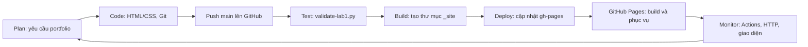

# BÁO CÁO LAB 1 — TRẢI NGHIỆM DEVOPS END-TO-END

**Họ tên:** Mua Mí Sính  
**MSSV:** DTC235180159 · **Lớp:** KTPM K22C  
**Ngày thực hành:** 15/10/2026

## 1. Sản phẩm

- Kho public: https://github.com/MuaMiSinh/devops-lab1-portfolio
- Website: https://muamisinh.github.io/devops-lab1-portfolio/
- CI/CD: https://github.com/MuaMiSinh/devops-lab1-portfolio/actions
- Web HTML/CSS có tên, MSSV, lớp, kỹ năng và liên kết mã nguồn/pipeline.
- Pipeline `.github/workflows/deploy.yml`: checkout → kiểm tra HTML → tạo `_site/` → xuất bản `gh-pages`. GitHub Pages build và phục vụ website từ nhánh này.

## 2. Quy trình thực hành

1. Kiểm tra kho đã có, nhánh `main`, trang portfolio và cấu hình Pages hiện hữu.
2. Bổ sung thông tin cá nhân, viewport responsive, landmark `main`, liên kết GitHub. Nhãn ngày là **Ngày xem**, vì giá trị được JavaScript tính tại trình duyệt, không phải thời điểm deploy.
3. Bổ sung script kiểm tra HTML bằng Python chuẩn, không cần dependencies. Kiểm tra doctype, ngôn ngữ, viewport, landmark và thông tin sinh viên. Đây là kiểm tra cơ bản, chưa thay thế HTML validator đầy đủ hay kiểm thử giao diện.
4. Build artifact chỉ gồm `index.html` và `.nojekyll`; không xuất bản cả kho giáo trình.
5. Commit và push `main`, theo dõi Actions, sau đó kiểm tra website online.
6. Đổi tiêu đề sang tiếng Việt, commit và push lần nữa để chứng minh nội dung tự cập nhật.

**Lưu ý nhánh:** sửa mã nguồn và push `main`. Pipeline tự cập nhật `gh-pages`; không cần chỉnh sửa trực tiếp nhánh xuất bản. Kho đã có `contents: write` để action có quyền cập nhật nhánh này.

## 3. So sánh DevOps và quy trình truyền thống

| Tiêu chí | Thủ công (Traditional) | DevOps (CI/CD) |
|---|---|---|
| Deploy thế nào? | Chép mã/build, upload lên server, cấu hình và kiểm tra bằng tay | Push `main` → Actions kiểm tra/build → xuất bản → Pages phục vụ |
| Mất bao lâu? | Tùy quy trình; ví dụ trong hướng dẫn là 15–30 phút, chưa đo trực tiếp | Thời gian thực tế xem ở từng run; không mặc định luôn 10 giây |
| Ai thực hiện? | Developer hoặc người vận hành thực hiện từng bước | Người viết cấu hình; runner tự thực hiện các bước đã định nghĩa |
| Sai sót? | Có thể bỏ bước, nhầm tệp hoặc nhầm cấu hình | Giảm sai sót do thao tác lặp lại; vẫn có thể lỗi mã, cấu hình, quyền hoặc dịch vụ |
| Rollback? | Tìm bản sao cũ và triển khai lại bằng tay | `git revert <commit>` rồi push `main`, pipeline triển khai phiên bản đã hoàn tác |
| Biết thành công? | Mở trang, kiểm tra file/log bằng tay | Kiểm tra Actions, trạng thái Pages và nội dung website thực tế |

## 4. Workflow

Trong triển khai này, kiểm tra HTML chạy trước bước đóng gói website để phát hiện lỗi sớm. Với web tĩnh không có bước biên dịch; Build là tạo thư mục xuất bản sạch.

## 5. Trả lời câu hỏi

**1. Những bước được tự động hóa?** Checkout mã nguồn, kiểm tra HTML, đóng gói tệp tĩnh, cập nhật nhánh xuất bản và build/deploy trên GitHub Pages. Người học vẫn xác định yêu cầu, viết mã, review và kiểm tra sản phẩm sau deploy.

**2. Website lỗi thì quay lại bản cũ thế nào?** Xác định commit gây lỗi, chạy `git revert <commit>` rồi `git push origin main`. Revert tạo commit mới và giữ lịch sử; theo dõi run mới đến khi thành công và xác nhận nội dung online. Không dùng reset cứng/force push cho bài này.

**3. Tiết kiệm bao nhiêu thời gian?** Pipeline giảm số bước thao tác triển khai thủ công xuống commit/push và theo dõi. Chưa đo một lần triển khai thủ công tương đương nên chưa thể kết luận số phút tiết kiệm thực nghiệm. Nếu dùng mốc giả định của giáo trình, mức tiết kiệm ước tính bằng 15–30 phút trừ tổng thời gian chờ CI và Pages; số thực tế nằm trong log và thời gian run đính kèm.

## 6. Kiểm chứng

- `python scripts/validate-lab1.py`: đạt trên HTML thật.
- Thử bản sao HTML thiếu MSSV: script trả lỗi, chứng minh kiểm tra có phát hiện thiếu nội dung.
- `git diff --check`: đạt.
- Lần triển khai đầu: commit `67eab5d`; [CI thành công](https://github.com/MuaMiSinh/devops-lab1-portfolio/actions/runs/38721116527), [Pages thành công](https://github.com/MuaMiSinh/devops-lab1-portfolio/actions/runs/38721139719).

Thông tin lần cập nhật tiếp theo và minh chứng được bổ sung sau khi chạy xong trong `KetQua_ThucHanh.md`. `logs/` lưu dữ liệu run lấy từ GitHub API; `screenshots/` lưu ảnh minh chứng, có mô tả nguồn trong `MinhChung.md`.
