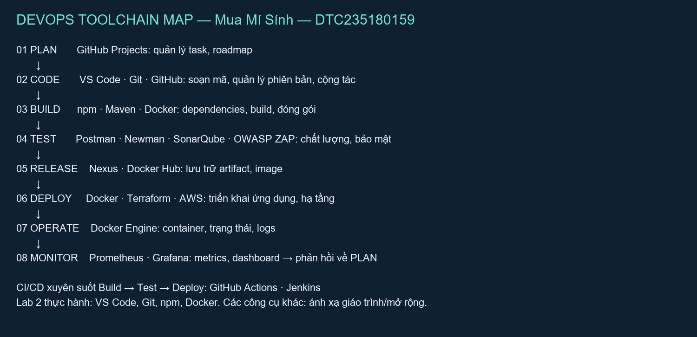
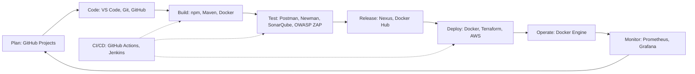

# BÁO CÁO LAB 2 — DEVOPS VÀ CALMS

**Sinh viên:** Mua Mí Sính · **MSSV:** DTC235180159 · **Lớp:** KTPM K22C  
**Ngày thực hành:** 15/10/2026

## 1. Công cụ và cách thực hiện

Chạy trong thư mục `BaiNop` bằng PowerShell:

```powershell
./devops-check.ps1
./setup-dev-env.ps1
docker build -t devops-lab2-app .
docker run -d -p 3000:3000 --name lab2-app devops-lab2-app
curl.exe http://localhost:3000
```

Script kiểm tra VS Code, Git, Docker, Node.js và kết nối Docker Engine. Các phiên bản và kết quả thực hành được lưu trong `logs/`. Git đã có cấu hình tác giả trong máy. VS Code đã có GitLens, Container Tools, YAML và Prettier; Markdown Preview tích hợp sẵn trong VS Code.

Docker Compose có sẵn dưới dạng `docker-compose.exe`, nhưng `docker compose` chưa được CLI nhận diện trên máy này. Lab sử dụng `docker build/run` nên không phụ thuộc Compose. Có thể gọi `docker-compose version` để kiểm tra bản độc lập.

## 2. Automation — giải pháp onboarding

Đưa ứng dụng, cấu hình và script vào cùng kho Git. Thành viên mới clone kho, chạy `setup-dev-env.ps1` để kiểm tra điều kiện, tạo `src/`, `tests/`, `docs/`, sao chép ứng dụng, tạo `.gitignore`, README và cài dependencies. Script tạo môi trường riêng tại `dev-env/`, giữ nguyên tệp đã có khi chạy lại. Dùng Git của kho bài tập, tránh tạo kho Git lồng bên trong.

Khi cần môi trường đồng nhất, build và chạy Docker bằng các lệnh trên. Node.js đã nằm trong image nên máy người chạy chỉ cần Docker. Mục tiêu hai phút là mục tiêu cải tiến, phụ thuộc mạng và cache; không phải cam kết mọi máy đều đạt. Thời gian chạy thật nằm trong log lần đầu và log chạy lại.

## 3. Lean — Docker

Ứng dụng HTTP trả JSON gồm `message`, `lab`, `timestamp`, `node_version`, `platform`. Image dùng `node:24-alpine` thay mẫu `node:18-alpine` của tài liệu để khớp dòng Node.js 24 của môi trường thực hành. Chỉ sao chép package và server vào image, chạy bằng user `node`. Tag 24 vẫn có thể đổi phiên bản vá; muốn tái tạo chính xác cần chốt digest image.

Gửi **cùng image đã build** cho đồng đội: Node.js và thư viện trong image vẫn giống nhau; trường `platform` là `linux` khi chạy Linux container, `message` giống nhau và `timestamp` thay đổi theo mỗi request. Máy đích cần Docker hỗ trợ kiến trúc image và cổng chưa bị chiếm.

```powershell
docker save -o devops-lab2-app.tar devops-lab2-app
# Trên máy nhận:
docker load -i devops-lab2-app.tar
docker run -d -p 3000:3000 --name lab2-app devops-lab2-app
```

| Lãng phí khi cài thủ công | Cải tiến với Docker |
|---|---|
| Mỗi người chọn một bản Node.js | Runtime nằm trong image dùng chung |
| Lặp lại hướng dẫn cài đặt | Script và Dockerfile được lưu trong Git |
| Khó tái hiện lỗi khác hệ điều hành | Dùng cùng môi trường Linux container |
| Khó chia sẻ cấu hình | Chia sẻ image và hướng dẫn chạy |

Dọn dẹp sau khi chấm: `docker stop lab2-app`, sau đó `docker rm lab2-app`.

## 4. DevOps Toolchain Map





| Giai đoạn | Công cụ | Lab liên quan theo giáo trình | Mục đích |
|---|---|---|---|
| Plan | GitHub Projects | Mở rộng | Task, roadmap |
| Code | Git, GitHub | 1, 5 | Phiên bản, cộng tác |
| Code | VS Code | 2 | Soạn mã và cấu hình |
| Build | npm, Docker | 2 | Dependencies, đóng gói image |
| Build | Maven | 7 | Build Java |
| Test | Postman, Newman | 6 | Kiểm thử API |
| Test | SonarQube | 6, 7 | Phân tích tĩnh |
| Test | OWASP ZAP | 6 | Kiểm thử bảo mật |
| Release | Nexus, Docker Hub | 7 / mở rộng | Lưu artifact và image |
| Deploy | Docker | 2, 7, 8 | Chạy container |
| Deploy | Terraform, AWS | 3 | Hạ tầng dạng mã và cloud |
| CI/CD | GitHub Actions, Jenkins | 1, 7 | Điều phối pipeline |
| Operate | Docker Engine | 2 | Quản lý container, logs |
| Monitor | Prometheus, Grafana | Mở rộng | Metrics, dashboard |

Các lab khác và công cụ mở rộng là ánh xạ theo chương trình, không phải khẳng định đã triển khai trong Lab 2.

| CALMS | Áp dụng trong bài này |
|---|---|
| Culture | Tài liệu hóa cách chạy và chia sẻ trách nhiệm; quy ước đề xuất là cùng tái hiện lỗi trước khi quy trách nhiệm |
| Automation | Script tạo cấu trúc, cấu hình và cài dependencies; chạy lại an toàn |
| Lean | Một image dùng chung, giảm bước cài đặt và sai lệch runtime |
| Measurement | Ghi phiên bản, thời gian setup, log build và phản hồi HTTP |
| Sharing | Mã nguồn, sơ đồ và báo cáo có thể gửi cho đồng đội |

## 5. Tự đánh giá CALMS

Đây là bản tự đánh giá đề xuất dựa trên phạm vi bài cá nhân, cần sinh viên xác nhận theo trải nghiệm thật; chưa có bằng chứng làm việc nhóm hoặc production.

| Nguyên tắc | Điểm /5 | Căn cứ |
|---|---:|---|
| Culture | 2 | Có hướng dẫn chung; chưa kiểm chứng phối hợp Dev/Ops |
| Automation | 3 | Tự động setup; chưa có pipeline hoàn chỉnh cho ứng dụng này |
| Lean | 4 | Chạy bằng Docker, script dùng lại được; tải image vẫn phụ thuộc mạng |
| Measurement | 2 | Có log, thời gian và HTTP; chưa có dashboard/alert |
| Sharing | 3 | Có báo cáo và sơ đồ; chưa có bằng chứng code review nhóm |
| **Tổng** | **14/25** | Còn dư địa cải thiện |

Ba hành động cải thiện:

1. Trong tuần tiếp theo, thêm GitHub Actions để kiểm tra cú pháp và build image mỗi lần tạo pull request; theo dõi tỷ lệ build thành công.
2. Trong hai buổi thực hành tiếp theo, thêm health check và ghi thời gian build/setup qua ít nhất ba lần chạy để so sánh trước và sau khi dùng cache.
3. Trong buổi làm nhóm tiếp theo, nhờ một bạn chạy lại từ kho Git, ghi thời gian onboarding và tạo một pull request có review để cập nhật hướng dẫn.

## Minh chứng

Kết quả kiểm tra ngày 15/10/2026: VS Code 1.141.2, Git 2.54.0.windows.1, Docker CLI/Engine 29.8.2, Node.js máy Windows v24.18.0. Setup lần đầu 13,97 giây, chạy lại 2,05 giây. Docker build thành công image `devops-lab2-app:latest` (ID `d8f7c2567313`); container `lab2-app` chạy và publish cổng 3000. HTTP trả `message: Hello from Docker!`, `node_version: v24.22.0`, `platform: linux`. Kiểm tra cú pháp Node.js và PowerShell đều đạt. Bản Node.js trong container khác phiên bản vá trên máy host minh họa việc runtime container độc lập host.

`logs/` chứa đầu ra lệnh thực tế. Ảnh 01–04 trong `screenshots/` là bản trình bày PNG từ log đã ghi, không phải ảnh chụp màn hình terminal. Ảnh 05 là sơ đồ, ảnh 06 là bảng tự đánh giá. Tệp `TaoMinhChung.py` cho phép tạo lại các ảnh từ log. Container được giữ chạy để kiểm tra khi bàn giao.
